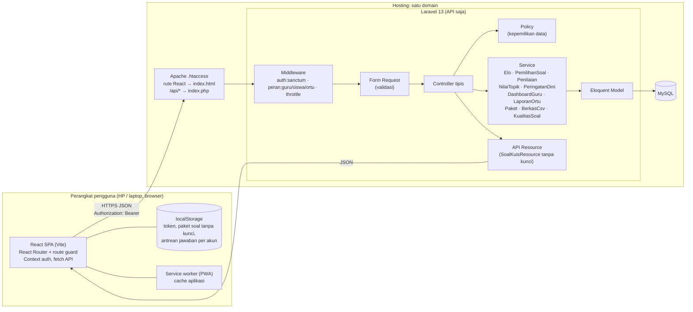
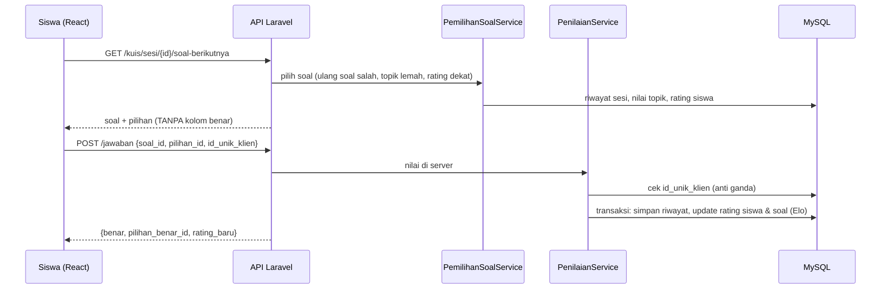
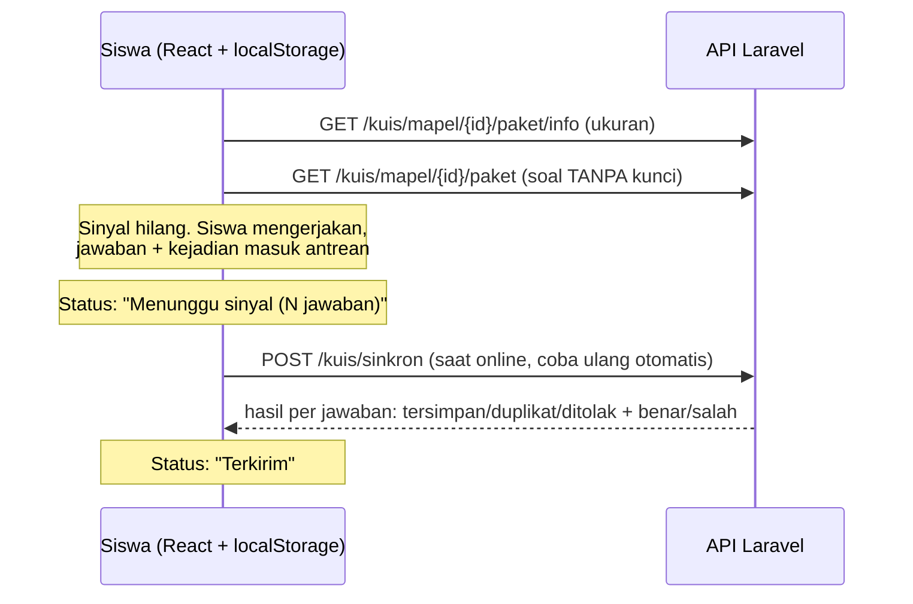
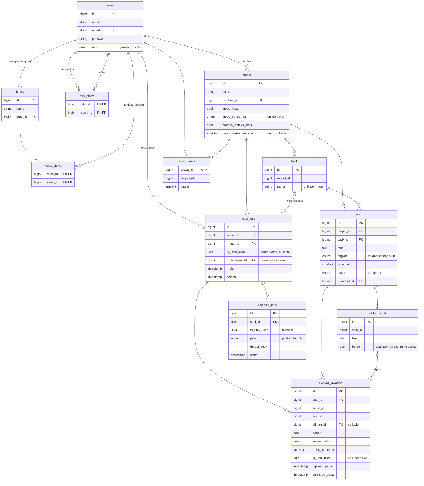

# Arsitektur Sistem Siaga Belajar

## Diagram arsitektur

Alur satu jawaban kuis:

Alur Mode Paket (koneksi tidak stabil):

## ERD

Indeks penting: `soal(mapel_id, status, rating_elo)` untuk pemilihan soal, `riwayat_jawaban(siswa_id, id_unik_klien)` UNIQUE untuk anti jawaban ganda, `riwayat_jawaban(sesi_id, id)` untuk riwayat sesi, `topik(mapel_id, nama)` UNIQUE.

Kolom tambahan dari rancangan awal: `sesi_kuis.id_unik_klien` dan `kejadian_kuis.id_unik_klien` (UNIQUE per siswa/sesi, agar sinkron ulang Mode Paket tidak membuat data ganda), `sesi_kuis.topik_fokus_id` (sesi remedial), `riwayat_jawaban.waktu_habis` (batas waktu Mode Ketat).

Catatan skema: kolom `pilihan_id` di `riwayat_jawaban` ditambahkan dari rancangan awal agar jawaban yang dipilih siswa tercatat (berguna untuk analisis pengecoh di tahap kalibrasi soal).

## Daftar endpoint

| Metode | Path | Peran |
|---|---|---|
| POST | `/api/login` | publik |
| GET | `/api/me` | semua |
| POST | `/api/logout` | semua |
| GET | `/api/mapel` | guru, siswa |
| GET | `/api/mapel/{mapel}` | guru, siswa |
| POST | `/api/guru/mapel` | guru |
| PATCH | `/api/guru/mapel/{mapel}` | guru pemilik |
| POST | `/api/guru/mapel/{mapel}/topik` | guru pemilik |
| GET | `/api/guru/mapel/{mapel}/soal` | guru pemilik |
| GET | `/api/guru/mapel/{mapel}/dashboard` | guru pemilik |
| POST | `/api/guru/soal` | guru pemilik mapel |
| GET / PUT / DELETE | `/api/guru/soal/{soal}` | guru pemilik |
| POST | `/api/kuis/sesi` | siswa |
| GET | `/api/kuis/sesi/{sesi}/soal-berikutnya` | siswa pemilik sesi |
| POST | `/api/kuis/sesi/{sesi}/jawaban` | siswa pemilik sesi |
| POST | `/api/kuis/sesi/{sesi}/selesai` | siswa pemilik sesi |
| POST | `/api/kuis/sesi/{sesi}/kejadian` | siswa pemilik sesi |
| GET | `/api/kuis/rekomendasi` | siswa |
| GET | `/api/kuis/mapel/{mapel}/paket/info` | siswa |
| GET | `/api/kuis/mapel/{mapel}/paket` | siswa |
| POST | `/api/kuis/sinkron` | siswa |
| GET | `/api/guru/mapel/{mapel}/ekspor/nilai` | guru pemilik |
| GET | `/api/guru/mapel/{mapel}/ekspor/soal` | guru pemilik |
| POST | `/api/guru/mapel/{mapel}/impor/soal` | guru pemilik |
| GET | `/api/guru/contoh-format-soal` | guru |
| GET | `/api/guru/mapel/{mapel}/kualitas-soal` | guru pemilik |
| GET | `/api/ortu/anak` | orang tua |
| GET | `/api/laporan/siswa/{siswa}` | orang tua dari siswa, guru pengajar |

Contoh request/response lengkap ada di [README](../README.md#dokumentasi-api).
